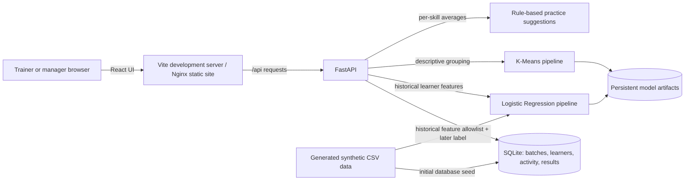

# Skill Pluse architecture

## Runtime structure

## Main code areas

| Area | Responsibility |
| --- | --- |
| `frontend/src/App.jsx` | Navigation, selected batch, dashboard loading and offline-demo fallback. |
| `frontend/src/services/api.js` | API requests and backend snake_case to UI camelCase conversion. |
| `frontend/src/pages/` | Overview, learners, assessments, skill gaps and reports. |
| `backend/app/api/` | FastAPI route handlers for batches, learners, assessments, analytics and AI support. |
| `backend/app/schemas/` | Pydantic request and response validation. |
| `backend/app/models/models.py` | SQLAlchemy relational tables and constraints. |
| `backend/app/db/` | SQLite sessions, schema initialization and synthetic-data seeding. |
| `backend/app/ml/train.py` | Logistic Regression evaluation and K-Means training. |
| `backend/app/ml/inference.py` | Historical feature aggregation and trainer-facing signals. |
| `backend/app/api/recommendations.py` | Benchmark-based practice suggestions from a learner's assessed skill history. |
| `data/synthetic/` | Fictional operational CSVs and the separate historical model snapshot table. |

## Data and model boundaries

SQLite contains operational training activity. `support_outcomes` and the `needed_support` label are follow-up outcomes and are not read by prediction inference. Training validates the timeline and uses an explicit four-column feature allowlist. The training pipeline performs a stratified 75/25 split, fitting the scaler and Logistic Regression only on the training partition. K-Means receives the historical features and no outcome label.

The model reports synthetic-only evaluation metrics and simple coefficient-based explanations. These are not calibrated or validated on real students. A support signal is for trainer review; it does not make an automatic placement or certification decision. Cluster numbers are arbitrary group labels.

## Deployment layout

Docker Compose builds a FastAPI service and a React static site served by Nginx. Nginx proxies `/api/` to FastAPI. The named `skillpulse_data` volume stores the SQLite database and trained model artifacts. The development Vite server proxies `/api/` to `127.0.0.1:8000` instead.
